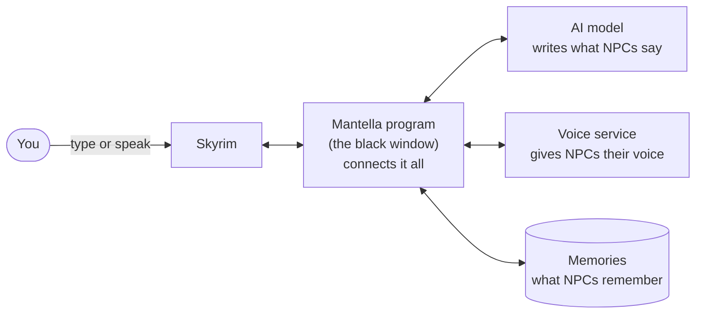
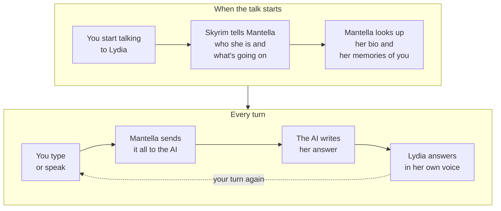
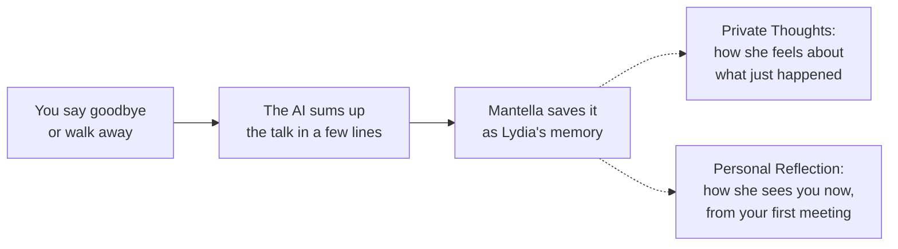

# Mantella Remake Handbook

This guide has five parts:

1. **[Quick Start](#part-1-quick-start):** install Mantella and talk to your first NPC. Nothing to fine-tune.
2. **[Fine-Tune Your Experience](#part-2-fine-tune-your-experience):** pick the microphone service, the voices and the AI models that suit you, and get to know the kinds of conversation, tags, quest tags, the lorebook, what NPCs think in private and the things NPCs can do.
3. **[How Mantella Works](#part-3-how-mantella-works):** what happens behind the scenes when you talk to someone.
4. **[Make It Better](#part-4-make-it-better):** the parts of Mantella you can improve, and where each one is explained.
5. **[Questions and Answers](#questions-and-answers):** fixes for common problems, and answers to common questions.

# Part 1: Quick Start

Follow the steps in order. You can skip anything marked **Optional**.

## Before you start

Check these four things first. Most install problems come from one of them.

- [ ] **Skyrim Special Edition, Anniversary Edition or VR**, on Windows 10 or 11. The old 2011 Skyrim (Legendary Edition) doesn't work.
- [ ] **Skyrim is not in Program Files.** Mantella can't write its files there. If Steam put it in `C:\Program Files (x86)\Steam`, move it to a folder like `C:\Games\Steam` (Steam → Settings → Storage lets you add a new library on another drive and move the game; steps are in **Moving Skyrim out of Program Files** below).
- [ ] **A mod manager.** We use Mod Organizer 2 (MO2) in this guide. Vortex works too.
- [ ] **Your Skyrim version number.** Some helper mods have a different download for each version. Find yours: right-click `SkyrimSE.exe` in the game folder → **Properties** → **Details** → **File version**. Write it down.

You also need a free Nexus Mods account to download the helper mods.

<details>
<summary><b>Moving Skyrim out of Program Files</b></summary>

Steam allows only one library folder per drive. So if you have a second drive, move Skyrim there. If you only have C:, move Steam itself out of Program Files, and Skyrim moves with it.

First, close Skyrim, your mod manager and anything else using the game folder. Your saves and Skyrim settings in `Documents\My Games` don't move and aren't touched.

**You have another drive (D: or similar)**

1. In Steam, open **Steam** → **Settings** → **Storage**.
2. Open the drive list at the top and pick **Add Drive**. Choose your other drive and press **Add**. Steam makes a `SteamLibrary` folder on it.
3. Pick the drive Skyrim is on now (usually C:) in the drive list. Tick **Skyrim Special Edition** (or **Skyrim VR**) and press **Move**.
4. Choose the new drive and press **Move**. Wait until Steam says it's done.

Skyrim is now in `D:\SteamLibrary\steamapps\common\Skyrim Special Edition` (your drive letter may differ).

**You only have C:**

1. Quit Steam fully: **Steam** → **Exit**. Closing the window isn't enough.
2. Make a folder `C:\Games`. Press **Continue** if Windows asks for permission.
3. Cut the whole `C:\Program Files (x86)\Steam` folder and paste it into `C:\Games`, so you have `C:\Games\Steam`. This can take a while.
4. Start Steam from `C:\Games\Steam\steam.exe`. It updates itself and signs you in.
5. Check that Skyrim shows as installed in your Steam library.
6. Make a new desktop shortcut to the new `steam.exe`. Old shortcuts point to the old folder.

Skyrim is now in `C:\Games\Steam\steamapps\common\Skyrim Special Edition`.

**Then point your mod manager at the new folder**

Anything already in the game folder moves with it. If you already set up a mod manager, it still points to the old place:

- **MO2:** close MO2 and open `ModOrganizer.ini`. It's in your MO2 folder, or in `%LOCALAPPDATA%\ModOrganizer\<instance name>` if you made a global instance. Change the `gamePath` line to the new folder, with double backslashes, for example `gamePath=@ByteArray(C:\\Games\\Steam\\steamapps\\common\\Skyrim Special Edition)`. Save and start MO2. Then open the programs list at the top right → **\<Edit...>** → **SKSE**, and set **Binary** to `skse64_loader.exe` in the new folder and **Start in** to the new folder.
- **Vortex:** open the **Games** page, open the menu on Skyrim's card → **Manually Set Location**, and pick the new Skyrim folder. Then press **Deploy Mods** if Vortex asks.

If SKSE is already installed, start the game through it once to check everything works.

</details>

## Step 1: Install the helper mods

Mantella needs these mods to work. Install each one with your mod manager, except SKSE and the Visual C++ download, which have their own instructions below.

| Mod | What it's for | Pick the right file |
| --- | --- | --- |
| [SKSE](https://skse.silverlock.org/) | Lets mods like Mantella run extra code in the game | The build that matches your Skyrim version. VR has its own build |
| [Address Library for SKSE Plugins](https://www.nexusmods.com/skyrimspecialedition/mods/32444) | Helps SKSE mods work on your Skyrim version | "All in one" for your edition. VR players use [VR Address Library](https://www.nexusmods.com/skyrimspecialedition/mods/58101) |
| [PapyrusUtil SE](https://www.nexusmods.com/skyrimspecialedition/mods/13048) | Extra tools Mantella's scripts use | The file for your Skyrim version |
| [SkyUI](https://www.nexusmods.com/skyrimspecialedition/mods/12604) | Gives you Mantella's in-game menu | Main file |
| [UIExtensions](https://www.nexusmods.com/skyrimspecialedition/mods/17561) | The typing box and the Conversation Wheel | Main file |
| [FonixData File](https://www.nexusmods.com/skyrimspecialedition/mods/40971) | Makes NPCs' lips move with their words | "Mod Manager Install" |
| [Microsoft Visual C++ Redistributable](https://aka.ms/vs/17/release/vc_redist.x64.exe) | Needed by the Mantella program | Run the file and press Install |

**Installing SKSE:** open the SKSE download, copy `skse64_loader.exe` and the `.dll` files into your Skyrim folder (next to `SkyrimSE.exe`). From now on, start the game with SKSE: in MO2, pick **SKSE** in the list at the top right and press **Run**.

**Nice to have:**

- [powerofthree's Papyrus Extender](https://www.nexusmods.com/skyrimspecialedition/mods/22854): NPCs notice deaths nearby, such as an enemy you just killed. Everything else works without it.
- [No NPC Greetings](https://www.nexusmods.com/skyrim/mods/746): stops NPCs' normal greetings from talking over their Mantella answers.

## Step 2: Install Mantella

1. Download and install Mantella Remake.zip from the newest release.
2. Turn the mod on: tick its box in MO2, or press **Enable** in Vortex.
3. In MO2's right-hand **Plugins** list, make sure `Mantella.esp` is ticked.

<details>
<summary><b>Already have the original Mantella?</b></summary>

Check its version in your mod manager (MO2's **Version** column).

**Version 0.14:** turn it off. Follow **Don't want to keep the original Mantella?** below.

**Older versions:** keep it installed and turned on. Install Mantella Remake as its own mod, then make it load after the original, so its files win wherever both mods have the same file:

- **MO2:** drag Mantella Remake below Mantella in the left-hand mod list.
- **Vortex:** when Vortex shows a conflict between them, set Mantella Remake to load after Mantella.

Mantella Remake replaces every file the two share, so they don't fight. The original keeps two things for you: your keys (the `*_SECRET_KEY.txt` files inside it) and its Piper voices. Your settings and what NPCs remember are in `Documents\My Games\Mantella`, so they carry over either way.

</details>

<details>
<summary><b>Don't want to keep the original Mantella?</b></summary>

You can remove it. Do these first, because some of your things live inside it:

1. **Your keys.** Open the original's mod folder (MO2: right-click it → **Open in Explorer**; Vortex: its menu → **Open in File Manager**). Copy every `*_SECRET_KEY.txt` file you find next to `Mantella.esp`, such as `GPT_SECRET_KEY.txt`, into Mantella Remake's mod folder, also next to its `Mantella.esp`.
2. **Optional: Piper voices**, if you use them: copy them into a mod of their own (see Optional: Piper voices in Step 4). Don't need Piper? Skip this: Mantella switches you to Pocket TTS by itself and says so in the black window.
3. **Optional: Your own user folder**, if you set one in `custom_user_folder.ini` (in its `SKSE\Plugins\MantellaSoftware` folder): note the folder written there, and set it again afterwards (see **"FileNotFoundError" in the black window** in Questions and Answers).
4. Remove the original Mantella in your mod manager, then start the game with Mantella Remake.

Your settings and what NPCs remember stay in `Documents\My Games\Mantella`, so they carry over.

</details>

<details>
<summary><b>Windows may warn you about <code>Mantella.exe</code></b></summary>

Windows Defender and some antivirus programs flag new programs they haven't seen before. If it gets blocked, allow it, and allow it through the firewall when Windows asks. Mantella only talks to the services you sign up for below.

</details>

### Updating Mantella Remake

1. Download the new Mantella Remake.zip.
2. **MO2:** install it the same way. MO2 asks what to do with the Mantella Remake you already have: pick **Replace**. **Vortex:** install it, then remove the old version.

Your settings, keys, voices and what NPCs remember aren't kept in Mantella Remake's own mod folder, so an update keeps them. Keep the original Mantella where it is.

### Restarting Mantella

Mantella starts by itself when you launch the game, so you never need to start `Mantella.exe` yourself. If its black window closes, or you want a fresh start, open the Mantella menu in the game (Esc → **System** → **Mod Configuration** → **Mantella** → **Advanced**) and pick **Restart Mantella.exe**. It closes the Mantella that's running and starts a new one.

## Step 3: Connect the AI models that write NPC answers

Mantella uses OpenRouter by defualt, a website that gives you one key for many AI models, including free ones.

1. Make a free account at [openrouter.ai](https://openrouter.ai).
2. Go to **Settings** → **API Keys** and press **Create Key**. Copy the key (it starts with `sk-or-`).

**Start the game once now.** Launch Skyrim through SKSE (see Step 1). A black Mantella window opens next to the game, and the settings page opens in your web browser. If the browser doesn't open, go to <http://localhost:4999/ui> while the Mantella window is open.

**Save your key.** On the settings page, open the **Game** tab → **Your keys**. Paste the key in the **OpenRouter key** box and press **Save key**. No restart needed.

**The AI model.** NPCs use OpenRouter's free models (openrouter/free) out of the box, so you can skip this for now. OpenRouter picks one of its free models for each answer. Free models cost nothing but can be slow or busy at peak times. For faster, smarter answers, add a few dollars of credit on OpenRouter, then open the **Large Language Model** tab on the settings page, press **Update** next to **Single NPC Model** and pick another model.


<details>
<summary><b>Optional: Run the AI on your own PC</b></summary>

You can run the AI on your own PC instead of OpenRouter: no account, no key, and your conversations never leave your PC. Skip the OpenRouter steps above if you do. Answers are usually slower and less clever than online models.

You need a strong graphics card, because Skyrim and the AI share its memory. With 8 GB of graphics memory, start with a model of about 7–8B at 4-bit (often written Q4). With 16 GB or more, 12–14B models work well.

1. Install a program that runs AI models on your PC, and start it with a model loaded. Start it before Skyrim each time.
2. When you load the model, set its context size (how much text it reads at once) to at least 8192. Mantella's requests are long: the NPC's bio, what they remember and the conversation so far.
3. On the settings page, open the **Large Language Model** tab. Set **Single NPC LLM Service**, **Multi-NPC & Radiant LLM Service** and **Summary LLM Service** to your program, as in the table below. Summaries are what NPCs remember after a talk.
4. In each of their **Model** boxes, type the name of the model you loaded, as your program shows it. **Update** only lists the models of online services, not the ones on your PC.
5. The Game Master, which picks who speaks in group conversations, Shout, NPC Events and NPC Initiative, uses OpenRouter out of the box. To run it on your PC too, turn off **Use Decision Model for Game Master**, set **Game Master LLM Service** to your program and type your model in **Game Master Model**.
6. Open **Advanced** at the bottom of the tab. Set **Single NPC Custom Token Count**, **Multi-NPC & Radiant Custom Token Count**, **Summary Custom Token Count** and **Game Master Custom Token Count** to the context size you loaded, for example 8192. Mantella can't tell a local model's size and uses 4096 otherwise.

| Program | What to put in the LLM Service box |
| --- | --- |
| [KoboldCpp](https://github.com/LostRuins/koboldcpp) | Pick **KoboldCpp** from the list |
| [text-generation-webui](https://github.com/oobabooga/text-generation-webui) | Pick **textgenwebui** from the list, and start text-generation-webui with its API turned on (`--api`) |
| [LM Studio](https://lmstudio.ai) | Type `http://localhost:1234/v1` |
| [Ollama](https://ollama.com) | Type `http://localhost:11434/v1` |
| [llama.cpp](https://github.com/ggml-org/llama.cpp) server | Type `http://localhost:8080/v1` |

Any other program that offers an OpenAI-style server works too: type the address it shows, ending in `/v1`. Mantella sends no key to a program on your PC.

</details>

## Step 4: Give NPCs their own voices

NPCs speak with Pocket TTS out of the box. It's free, runs on your PC's processor (so your graphics card stays free for Skyrim) and copies each NPC's real voice from their lines in the game.

Pocket TTS needs a free Hugging Face sign-in, done once:

1. Make a free account at [huggingface.co](https://huggingface.co).
2. Open the [kyutai/pocket-tts](https://huggingface.co/kyutai/pocket-tts) page and accept its terms.
3. Go to your profile picture → **Access Tokens** → **Create new token**. Pick **Read**, give it any name, and copy the token (it starts with `hf_`).
4. On Mantella's settings page, open the **Text-to-Speech** tab → **Settings for** → **Pocket TTS** → **Global settings for Pocket TTS** → **Turn on voice cloning**. Paste the token and press **Save token**. It should say your sign-in works.

**What to expect:** the first time Mantella starts, Pocket TTS downloads itself (about 230 MB for one language), often while you're still in Skyrim's main menu. The black Mantella window says when the download starts and shows **Pocket TTS: ready** when it's done. Wait for that line before your first conversation: an NPC who speaks earlier stays silent until the download finishes. After that, each NPC sounds like themselves.

**Skipped the sign-in?** NPCs still talk, but each one gets one of a few built-in voices instead of their own.

Pocket TTS speaks English, French, German, Portuguese, Italian, Spanish and Dutch. It needs a processor from about 2013 or newer. Want different voices? See [Which Voice and Speech Service to Pick](https://github.com/dreaminalife/Mantella/blob/personal_use/FEATURES_README.md#which-voice-and-speech-service-to-pick) for online services such as Inworld and HeyGen.

<details>
<summary><b>Optional: Piper voices</b></summary>

Piper is the voice service the original Mantella used. It runs on your PC with no sign-in, but NPCs of the same kind (for example, all male Nords) share one voice. Piper doesn't come with Mantella Remake: it comes inside the original Mantella, in its `SKSE\Plugins\MantellaSoftware\piper` folder (about 4 GB).

**Kept the original Mantella on, under Mantella Remake (Step 2):** Piper keeps working. Nothing to do.

**Removing the original Mantella, or never had it:** copy its `piper` folder into a mod of its own, so Piper stays when you update Mantella Remake. Never had the original? Download it from [Nexus](https://www.nexusmods.com/skyrimspecialedition/mods/98631) and take the `piper` folder from the zip instead of from the old mod. Don't install the rest of it.

- **MO2:** right-click the original Mantella → **Open in Explorer** to find the old `piper` folder. Then right-click an empty spot in the mod list → **Create empty mod** and name it `Piper`. Right-click the new mod → **Open in Explorer**, make the folders `SKSE\Plugins\MantellaSoftware` inside it, and copy the `piper` folder into `MantellaSoftware`. Turn the new mod on.
- **Vortex:** on the **Mods** page, open the original Mantella's menu → **Open in File Manager** to find the old `piper` folder. Make a new folder anywhere with `SKSE\Plugins\MantellaSoftware` inside it, copy the `piper` folder into `MantellaSoftware`, zip the `SKSE` folder and install the zip like any mod.

Then open the **Text-to-Speech** tab and pick **Piper** as the **TTS Service**. If Piper was your voice service and Mantella can't find it, it switches you to Pocket TTS by itself and says so in the black window.

</details>

<details>
<summary><b>Optional: xVASynth voices</b></summary>

xVASynth is another voice service the original Mantella offered. It runs on your PC with no sign-in, with a voice model for each kind of Skyrim voice. It's a separate program with its own voice downloads, installed outside Mantella.

**Already use xVASynth with another version of Mantella:** there's nothing to copy. xVASynth lives in its own folder, and your voice service choice and xVASynth folder are kept in `Documents\My Games\Mantella`. Keep xVASynth where it is. To check, open the **Text-to-Speech** tab: **TTS Service** should say **xVASynth**, and **xVASynth Folder** (under **xVASynth**) should point to the folder that holds `xVASynth.exe`.

**New to xVASynth:**

1. Download xVASynth from [Steam](https://store.steampowered.com/app/1765720/xVASynth/) (easiest) or [Nexus](https://www.nexusmods.com/skyrimspecialedition/mods/44184). Don't put it in your Skyrim folder.
2. Download the Skyrim voice models into xVASynth's `resources\app\models\skyrim` folder. Pick one way:
   - **With Nexus Premium:** in xVASynth, press **Get More Voices** (bottom left), untick every game except Skyrim, press **Check now**, then **Download All**. You may need to restart the download a few times.
   - **By hand:** download each voice model from the **Optional** files on the [xVASynth Nexus page](https://www.nexusmods.com/skyrimspecialedition/mods/44184?tab=files), unzip it into that folder, then delete the zip.
   - **By torrent:** the [original Mantella guide](https://art-from-the-machine.github.io/Mantella/pages/installation.html) has one torrent with every Skyrim voice.
3. On Mantella's settings page, open the **Text-to-Speech** tab and pick **xVASynth** as the **TTS Service**. Under **xVASynth**, set **xVASynth Folder** to the folder that holds `xVASynth.exe`. Mantella starts xVASynth by itself.

Short on space? **Male Nord** and **Male Soldier** are enough to talk to guards. If the first voice model never finishes installing, make the `skyrim` folder inside `resources\app\models` yourself and try again. For more emotional voices in English, add the [xVASynth DeepMoji Plugin](https://www.nexusmods.com/skyrimspecialedition/mods/107142).

</details>

## Step 5: Type, or talk with your voice

Mantella starts with typing: during a conversation, press **H** to open the typing box.

**Set your keys.** In the game, open the Mantella menu (Esc → **System** → **Mod Configuration** → **Mantella** → **General** → **Controls**) and set these four:

- **Start Conversation / Add NPC** starts a conversation with the NPC you're looking at, or adds them to the one you're in. It has no key until you set one.
- **End Conversation / Remove NPC** ends the conversation when you're looking at nobody, or takes the NPC you're looking at out of it. It has no key until you set one.
- **Open Text Prompt** opens the typing box. It's **H** until you change it.
- **Open Conversation Wheel** shows everything you can do right now in one menu. Hold the key, point at an option and click. It has no key until you set one. Recommend the side keys on your mouse. **Don't skip this one:** it's how you start most of Mantella's features, like Shout and NPC Events.

**Want to talk instead?** Set up speech-to-text first: it turns what you say into text, and takes a few extra steps. [Speech-to-Text Services](https://github.com/dreaminalife/Mantella/blob/personal_use/FEATURES_README.md#speech-to-text-services) shows how (see its **Quick start**). Then, in the same menu → **General**, turn on **Microphone → Enabled**. Set your microphone as the default in Windows (Settings → System → Sound → Input), and unplug or turn off other microphones, such as a webcam's, so Mantella hears the right one.

## Step 6: Your first conversation

1. Start Skyrim through SKSE and load a save. Check that the black Mantella window is open. The first time, wait until it shows **Pocket TTS: ready** (see Step 4 if there is an issue).
2. Look at an NPC and press your **Start Conversation / Add NPC** key (see Step 5). The NPC turns to you, and the Mantella window shows the conversation starting.
3. Press **H** and type what you say. With the microphone on, speak when you see **Listening...** at the top left.
4. The NPC answers out loud, with subtitles.
5. To end, look away from everyone and press your **End Conversation / Remove NPC** key (see Step 5).

Congrats! Now you got Mantella Remake working. We know this might feel overwhelming at first, but as you spend some time just playing around and enjoying the game, everything will begin to make sense. We encourage everyone to explore new features freely on their own, and don't worry you will not break anything. It is fun.

### Something else to try

- **Talk to a group:** during a talk, look at another NPC and press your **Start Conversation / Add NPC** key to add them. To take someone out, look at them and press your **End Conversation / Remove NPC** key.
- **Other kinds of conversations:** hold your **Open Conversation Wheel** key (from Step 5) and pick one:
  - **Companions:** talk with all your companions nearby at once.
  - **Say to Room:** say something out loud to nobody in particular, and see who answers. [More](https://github.com/dreaminalife/Mantella/blob/personal_use/FEATURES_README.md#say-something-to-the-room)
  - **NPC Event:** NPCs near you start a scene of their own. Watch it, or pick **Step in** to join. [More](https://github.com/dreaminalife/Mantella/blob/personal_use/FEATURES_README.md#npc-events)
  - **Approach:** if someone nearby has a reason to talk to you, they come over. [More](https://github.com/dreaminalife/Mantella/blob/personal_use/FEATURES_README.md#npc-initiative)
- **During a conversation**, the wheel offers more:
  - **Shout:** everyone in earshot hears you and can join in. [More](https://github.com/dreaminalife/Mantella/blob/personal_use/FEATURES_README.md#shout)
  - **Talk Event:** something unplanned happens to the people you're talking with, and they react. [More](https://github.com/dreaminalife/Mantella/blob/personal_use/FEATURES_README.md#talk-nearby-and-random-events)
  - **Nearby Event:** something happens among people nearby, and Shout turns on so they can join.
  - **Random Event:** either one. Mantella decides.
- **Director Mode:** you're not in the scene, you direct it. What you type becomes something that happens, like *A guard bursts in, shouting that a dragon is attacking*, and the NPCs act it out. Turn it on in the settings page → **Large Language Model** tab → **Multi Conversation Director Mode**. [More](https://github.com/dreaminalife/Mantella/blob/personal_use/FEATURES_README.md#multi-conversation-director-mode)

**Want to know more?** [The feature guide](https://github.com/dreaminalife/Mantella/blob/personal_use/FEATURES_README.md) explains each kind of conversation and how to make the most of it.

**Something not working?** See [Questions and Answers](#questions-and-answers) at the end of this guide, or [the feature guide](https://github.com/dreaminalife/Mantella/blob/personal_use/FEATURES_README.md).

# Part 2: Fine-Tune Your Experience

Part 1 sets everything to a starting choice that works for most players. This part explains the big choices you can change, so you can pick what suits your PC, your language and your budget. Each section links to the [feature guide](https://github.com/dreaminalife/Mantella/blob/personal_use/FEATURES_README.md) for the full setup.

## Speech-to-text: how NPCs hear you

Speech-to-text turns what you say into the microphone into text, which Mantella sends as your line. It's only used with the microphone on (see Step 5). If you type, skip this section.

What makes one service better than another:

- **Getting Skyrim names right.** Mantella sends the names around you (the NPCs, the place, your character) with each recording, so "Balgruuf" doesn't come out as "Bal Groove". Some services can't be sent these names, so they spell them the way they sound.
- **Your language.** The starting choice, Moonshine, only understands English.
- **Your PC.** Services on your PC are free, but the best ones need an NVIDIA graphics card, which Skyrim is already using. Online services usually have better quality, some are free as well. 

Personally I would recommend Deepgram because it has 200 USD free credit which you can use forever, and it is online so no need to download anything. It is also fast and accurate. See the links below for details.

**Which one to pick:** [Which Voice and Speech Service to Pick](https://github.com/dreaminalife/Mantella/blob/personal_use/FEATURES_README.md#which-voice-and-speech-service-to-pick) compares every service, and [Speech-to-Text Services](https://github.com/dreaminalife/Mantella/blob/personal_use/FEATURES_README.md#speech-to-text-services) sets each one up.

**To switch:** settings page → **Speech-to-Text** tab → **Speech-to-Text Service**, then press **Test** at the end of the page. If NPCs cut you off mid-sentence, raise **Pause Threshold** on the same tab.

## Text-to-speech: how NPCs sound

Text-to-speech turns each line the AI writes into speech. The game hands the voice service a few of the NPC's real lines, and it copies their voice from them, so Lydia sounds like Lydia. NPCs from mods with voices of their own are copied the same way.

What makes one service better than another:

- **Copying each NPC's own voice.** Every service in the table below copies the voice on the spot from the NPC's own lines, so there's nothing to download for each voice. This matters most for NPCs with voices of their own, like followers from mods: they keep their real voice. Piper and xVASynth from the original Mantella can't copy. They use a ready-made voice for each kind of NPC, so a modded follower sounds like any other NPC of their kind.
- **How lively it sounds.** Online services usually put more feeling into a line.
- **Cost.** Online services charge for each character spoken. They usually have better quality.
- **Your PC.** Pocket TTS runs on the processor, so your graphics card stays free for Skyrim. Its quality is great for a local service.

| What you want | Pick | Price per million characters |
| --- | --- | --- |
| Free, on your PC | **Pocket TTS** (the starting choice) | Free |
| Good quality  | **Inworld**, model TTS-2 Flash | $15 |
| The liveliest voices | **HeyGen**, model Turbo | $8. Model Turbo Free costs nothing until Nov 30, 2026 |
| The liveliest voices | **Iodine**, Iodine v2 | ~$7.5 |
| Online, without paying at first | **Boson AI** | $15, after a $10 trial credit |
| The best sound, whatever it costs | **ElevenLabs** | $40 |

Pocket TTS speaks English, French, German, Portuguese, Italian, Spanish and Dutch.

**To switch:** settings page → **Text-to-Speech** tab → **TTS Service**. You can also tune each voice on its own, such as its pitch, how lively it sounds and how fast it talks, or give ghosts and others a voice effect. Piper and xVASynth from the original Mantella are in [Step 4](#step-4-give-npcs-their-own-voices).

**Laughs, moods and directions:** NPCs can laugh, sigh, sound angry or scared, or say a line "quietly, trying not to laugh". Inworld, HeyGen, Qwen, Boson AI and Iodine can do this. Turn on **Audio tags** or **Directions** in that service's part of the **Text-to-Speech** tab. Both are off at first.

**Read more:** [Which Voice and Speech Service to Pick](https://github.com/dreaminalife/Mantella/blob/personal_use/FEATURES_README.md#which-voice-and-speech-service-to-pick) compares every service, and [Text-to-Speech Services](https://github.com/dreaminalife/Mantella/blob/personal_use/FEATURES_README.md#text-to-speech-services) sets each one up.

## AI models: who writes the answers

The AI model writes every word NPCs say. How good those words are doesn't come down to the model alone.

### What shapes every answer

Five things decide how good an NPC's answer is. When answers come out flat, wrong or out of character, one of these is usually why:

1. **The model:** which AI writes the answer. This makes the biggest difference.
2. **The model's settings/parameters:** how freely it writes, and how much it thinks first.
3. **The provider:** which company runs the model for you. The same model can sound better or worse depending on who runs it.
4. **The bio:** who the NPC is, as Mantella tells the model.
5. **The prompts:** Mantella's instructions to the model, such as how to talk and how long to answer.

Each one is explained below. Change one at a time, and try it with an NPC you know well, so you can tell what made the difference.

### The model

The same NPC, with the same bio and memories, can feel flat with one model and alive with another.

The starting choice, `openrouter/free`, picks one of OpenRouter's free models for each answer. It costs nothing, but it can be slow or busy at peak times, and because the model can change from one answer to the next, an NPC doesn't always sound the same.

**What makes a model good for roleplay:**

- **It stays in character.** It talks like a Nord housecarl, not like a helpful assistant, and never steps out of the story to explain itself.
- **It writes short, spoken lines.** NPCs say everything out loud, so long speeches and described actions, like *smiles warmly*, sound wrong.
- **It follows Mantella's instructions**, such as how long to answer, or when to use [NPC actions](https://github.com/dreaminalife/Mantella/blob/personal_use/FEATURES_README.md#npc-actions).
- **It starts answering fast.** An NPC can't speak until the first sentence arrives. Models that think before they answer can leave a few seconds of silence.
- **It goes along with darker scenes.** Some models refuse violence or mature roleplay. [Decensor Bypass](https://github.com/dreaminalife/Mantella/blob/personal_use/FEATURES_README.md#decensor-bypass) helps with those.
- **It can read a lot at once.** Each answer comes with the NPC's bio, their memories and the conversation so far. A model that reads more keeps more of it in mind.

**Finding one:** add a few dollars of credit on OpenRouter, then press **Update** next to a model setting. The list shows each model's price per million tokens (see [What it costs](#what-it-costs)). OpenRouter's [rankings](https://openrouter.ai/rankings) show which models people use most for roleplay. Try two or three, and keep the one that sounds most like the NPC.

### The model's settings

A few settings change how a model answers:

- **Temperature:** how much the answers vary. Lower (around 0.7) is steadier and follows instructions better. Higher (1 and up) is more surprising, but can drift out of character. If NPCs ramble or say odd things, lower it. If every answer sounds the same, raise it a little.
- **Reasoning:** whether the model thinks before it answers, and how much (see below).
- **Max tokens:** the most the model may write back in one answer, which caps its cost. Thinking counts toward it, so set it too low and a thinking model's reply gets cut off.

**Thinking first (reasoning).** Some models can think before they answer. You never hear the thinking, but you pay for it like a reply, and the NPC stays silent while it happens. Many models let you choose how much they think:

| | More thinking | Little or no thinking |
| --- | --- | --- |
| Good at | Following many rules at once, keeping a group scene straight, picking the right [NPC action](https://github.com/dreaminalife/Mantella/blob/personal_use/FEATURES_README.md#npc-actions), staying true to a long bio | Answers start fast and cost less. Enough for everyday chat |
| Watch out for | A few seconds of silence before each answer, and a bigger bill | Forgets a rule or slips out of character more often |

**Where to set them:** the **Model Profiles** tab. A profile belongs to one model, so its settings follow the model when you switch, and switching back and forth is quick. The tab has an example to copy. Then turn on **Apply Profile for One-on-One Conversations** (and the others you want) on the same tab. Without a profile, or with that switch off, one-on-one talks use the **Single NPC Parameters** box on the **Large Language Model** tab. See [Multiple Profile System](https://github.com/dreaminalife/Mantella/blob/personal_use/FEATURES_README.md#multiple-profile-system) for how profiles work, and [OpenRouter's list of settings](https://openrouter.ai/docs/parameters) for every setting a model can take.

### The provider

On OpenRouter, the same model is often run by several companies. Each has its own price and speed, and some answer noticeably better than others. By default, OpenRouter picks one for you, and it can change from one answer to the next.

If a model sounds worse than others say it should, or uneven from one answer to the next, pick which providers may answer. This goes in the model's profile on the **Model Profiles** tab: the example there shows how. Like the other settings, it's in [Multiple Profile System](https://github.com/dreaminalife/Mantella/blob/personal_use/FEATURES_README.md#multiple-profile-system).

### The bio

The model knows an NPC only through their bio and their memories of past talks. A thin bio gives a thin character: the model fills the gaps with a generic Skyrim NPC. A bio that says who they are, how they talk and what they care about gives the model something to play.

Most NPCs come with a bio. To read or change one, open the **Bio Editor** tab. If an NPC keeps acting wrong in the same way, read their bio first: the problem is often there, not in the model.

### The prompts

The prompts are Mantella's instructions to the model, on the **Prompts** tab. The same model, with the same settings, can answer very differently when they change. Mantella's own prompts work well with most models, so you rarely need to touch them. But if NPCs keep getting something wrong with every model you try, a clearer prompt can help as much as a better model. If you changed a prompt and answers got worse, reset it to the default. See [The instructions sent to the AI](#the-instructions-sent-to-the-ai).

### What it costs

Models charge by the token, a small piece of text (a token is about three-quarters of a word). Each model has two prices, both per million tokens:

- **What's sent to the model.** Every answer sends Mantella's instructions, the NPC's bio, their memories and the whole conversation so far, all over again. This is usually most of the bill, and it grows as a talk goes on.
- **What the model writes back.** The NPC's line, plus any thinking the model does first. Each token usually costs more, but there are far fewer of them.

For example, if each answer sends about 8,000 tokens and the model charges $0.50 per million for them, 100 answers cost about $0.40, plus a little for the replies. The bill grows with a pricier model, longer talks and more memories, more thinking, and more requests: group talks with Game Master Mode, summaries after each talk, and NPC Events each count.

### Different jobs, different models

Mantella uses models for several jobs, each with its own setting on the **Large Language Model** tab. Pay for a better model only where it matters:

| Setting | What it writes | What to look for |
| --- | --- | --- |
| **Single NPC Model** | Your one-on-one conversations | The best roleplay model you can afford. Speed matters |
| **Multi-NPC & Radiant Model** | Group conversations, and NPCs chatting with each other | The same. With Game Master Mode, every NPC who speaks is a request of its own, so the price adds up faster |
| **Summary Model** | The memory each NPC keeps after a talk | Accurate and good at following instructions, not creative. It works after the talk ends, so speed matters less, and a cheaper model is often enough |
| **Private Thoughts Model** and **Personal Reflection Model** | How an NPC feels after a talk, and how they see you over time. Both are off at first | They use the Summary Model unless you turn off **Use Summary Model for Private Thoughts** or **Use Summary Model for Personal Reflection**. A model that writes with insight makes them richer |
| **NPC Event Generator Model** | The scenes [NPC Events](https://github.com/dreaminalife/Mantella/blob/personal_use/FEATURES_README.md#npc-events) make up | Creative, with ideas of its own |
| **Game Master Decision Model** | Who speaks next in a group | Leave the starting choice: a small, fast model made for picking |
| **Fallback Model** | Answers when the main model fails. Off at first: turn on **Use Fallback Model on LLM Errors** | A different, reliable model, ideally on another service |

More model settings, such as a stronger model for your favorite follower, are in [More model settings](#more-model-settings).

## Kinds of conversations

Mantella has two ways to run a conversation with two or more NPCs. One-on-one talks are the same either way.

- **Game Master Mode** (on at first, and our pick): a Game Master works like a director. It picks who speaks next, and then that NPC answers on their own, knowing only their own bio and memories.
- **The original way:** one request writes every NPC's lines at once, with everyone's bio and memories in front of the model.

The difference: with the Game Master, each NPC is played on their own, so they keep their own voice and their own secrets. The original way plays everyone at once, so NPCs often sound alike or know what only someone else should, and might have coherence issues. We didn't deprecate the original mode because we want to give users more choices.

### Group conversations: Game Master Mode

**Why it makes group talks better:**

- **Every NPC sounds like themselves.** Each one answers alone, from their own bio and memories, so Lydia and Serana never blur into one voice.
- **Secrets stay secret.** An NPC knows only their own memories and what they were there to hear. Serana can't let slip something only Lydia knows.
- **The right person answers.** Ask Lydia a question and Lydia answers. When one NPC turns to another, that one answers back, so the scene flows like a real talk instead of a round of speeches.
- **You set the pace.** The talk settings decide who must answer before your turn, who answers first when someone is spoken to, how many replies come in a row before it's your turn again, and how often one NPC may speak. Want only the person you asked to answer? Or a lively back-and-forth while you listen? Both are a few clicks away, on the **Conversation** page. The original way writes all the lines in one go, so none of this can be set there. Read more: [Talk Level](https://github.com/dreaminalife/Mantella/blob/personal_use/FEATURES_README.md#talk-level).
- **NPCs talk to each other.** They can trade a few lines between themselves, then hand the turn back to you. Send `.` to let them keep going without saying anything yourself.
- **No waiting between lines.** While one NPC is speaking, the next one's answer is already being written, so it's usually ready when the line ends.

**Why there's a second way.** The original way is how Mantella first wrote group talks, and Game Master Mode was built to fix its problems: NPCs sounding alike, knowing each other's secrets, or one of them taking over the scene. The original way is still there for players who want the fewest requests: Game Master Mode sends one small request to pick the speaker and one for each NPC who speaks.

**To switch:** **Large Language Model** tab → **Multi-NPC Game Master Mode**. Shout, Say to Room and NPC Events always use a Game Master, even with it off. Read more: [Game Master Mode](https://github.com/dreaminalife/Mantella/blob/personal_use/FEATURES_README.md#game-master-mode).

### The Conversation Wheel: don't play without it

The wheel is where you start most of what Mantella can do, and much of it has no other button in the game. Without it, you mostly get one-on-one and group talks. With it, you can shout so the whole tavern hears you, call out to the room, have a nearby NPC come over with a reason to talk, start a scene between NPCs, throw a surprise into a talk, show NPCs what you see, or bring all your companions in at once.

It has no key until you set one, so many players never find it. Set it now: Esc → **System** → **Mod Configuration** → **Mantella** → **General** → **Controls** → **Open Conversation Wheel**. A side button on your mouse works well.

**Make it a habit:** whenever you wonder what you can do, hold the key. The wheel only shows what makes sense right now, in a conversation or out of one, and pointing at an option tells you what it does. Let go without clicking to close it. Read more: [Conversation Wheel](https://github.com/dreaminalife/Mantella/blob/personal_use/FEATURES_README.md#conversation-wheel).

### Every kind of conversation

| Kind | What happens | How to start it |
| --- | --- | --- |
| **One-on-one** | You and one NPC take turns | Look at an NPC and press your **Start Conversation / Add NPC** key |
| **Group** | You and several NPCs. Add or take out people as you go | The same key on more NPCs, or cast the **Mantella** spell without aiming at anyone |
| [**Shout**](https://github.com/dreaminalife/Mantella/blob/personal_use/FEATURES_README.md#shout) | The conversation turns public. Mutter to Lydia that the Jarl's steward is a fool, and Proventus, standing right behind you, can turn around and answer | Wheel → **Shout**, during a conversation |
| [**Say to Room**](https://github.com/dreaminalife/Mantella/blob/personal_use/FEATURES_README.md#say-something-to-the-room) | Call out to nobody in particular, like "Who here has seen a Khajiit with a stolen amulet?", and see who answers | Wheel → **Say to Room** |
| [**Director Mode**](https://github.com/dreaminalife/Mantella/blob/personal_use/FEATURES_README.md#multi-conversation-director-mode) | You're not in the scene. What you type becomes something that happens, and the NPCs act it out | **Large Language Model** tab → **Multi Conversation Director Mode** |
| [**Talk, Nearby and Random Events**](https://github.com/dreaminalife/Mantella/blob/personal_use/FEATURES_README.md#talk-nearby-and-random-events) | A surprise drops into a conversation that's stuck, like a dagger thudding into the table with a note tied to it | Wheel, during a conversation |
| [**NPC Initiative**](https://github.com/dreaminalife/Mantella/blob/personal_use/FEATURES_README.md#npc-initiative) | An NPC with a real reason to talk walks up to you, like the merchant you promised to bring something back to | Wheel → **Approach**. To have it happen on its own, Mantella menu → **NPC Initiative** → **Enabled** |
| [**NPC Events**](https://github.com/dreaminalife/Mantella/blob/personal_use/FEATURES_README.md#npc-events) | NPCs near you act out a scene of their own. Watch, walk away or step in | Wheel → **NPC Event**. To have it happen on its own, Mantella menu → **Events** → **Enabled** |

How much NPCs talk among themselves before it's your turn is set by [Talk Level](https://github.com/dreaminalife/Mantella/blob/personal_use/FEATURES_README.md#talk-level).

## Character tags

**What they are:** a tag is a piece of background that many NPCs share, like what everyone in Whiterun knows about their hold. The tag's text is written once, and every NPC with the tag gets it in their bio.

**Why you want them:** out of the box, an NPC only knows their own bio. Tags give whole towns, guilds and factions the same knowledge, without rewriting hundreds of bios. Change a tag once, and everyone with it knows.

**What's already there:** Mantella Remake comes with the community character pack ([Nexus](https://www.nexusmods.com/skyrimspecialedition/mods/174770)): over 1,000 tags, already given to about 2,500 NPCs. They cover the holds, guilds and factions, jobs like trainers and blacksmiths, the DLCs, and NPCs from popular mods such as 3DNPC and Immersive Wenches. Tags are on at first (**Large Language Model** tab → **Feature Toggles** → **Enable Character Tag Reading**).

**Making them your own:**

- **Change what a tag says:** open the **Tag Editor** tab, pick the tag (type to search) and edit its text.
- **Give a tag to an NPC:** open the **Bio Editor** tab, pick the NPC and add the tag.
- **Make a new tag:** add it to a file of your own in `Documents\My Games\Mantella\data\Skyrim\bio_templates`, or create it in the **Tag Editor**.

**Read more:** [Character Tags](https://github.com/dreaminalife/Mantella/blob/personal_use/FEATURES_README.md#character-tags) and [Tag Editor](https://github.com/dreaminalife/Mantella/blob/personal_use/FEATURES_README.md#tag-editor).

## Quest tags

**What they are:** tags that follow your quests. Each one has a text for every way a quest can end, and Mantella checks your game to see which one is true right now. Win the Battle for Whiterun, and Adrianne at the forge and everyone else with the tag know the attack failed. You don't edit anything.

**What's tracked:** the community character pack comes with quest tags for the main quest, the Civil War (who holds each hold), the Dark Brotherhood, the Thieves Guild, the College of Winterhold, the Daedric quests, Dawnguard, Dragonborn, many side quests and favors, whether important people are alive or dead, and quests from some popular mods.

**How it works for you:**

- NPCs with the tag know in their next conversation. If a quest moves on while you talk, the people with you hear about it with your next line.
- Each playthrough is tracked on its own, and loading an older save puts NPCs back to what was true then.
- Start using it in the middle of a playthrough, and everything you've already done counts as background: NPCs know it, but don't all bring it up at once.

**The setting:** **Large Language Model** tab → **Feature Toggles** → **Auto Quest Tag Outcomes**. **Static** (the starting choice) puts what happened in the NPC's bio: they know it, but aren't nudged to bring it up. **Dynamic** adds it as news in their memories, so they're likely to mention it. **Off** turns quest tags off.

**Read more:** [Quest Tags](https://github.com/dreaminalife/Mantella/blob/personal_use/FEATURES_README.md#quest-tags-tag-feature).

## Lorebook

**What it is:** facts that come up only when they matter. Each entry has a key, such as a place or a name, and a description. When the key turns up, in where you are, in what someone says, or in what just happened, its description goes along with the NPC's next answer. The rest of the time it stays out, so it doesn't crowd out everything else or cost anything.

**Why you want it:** for your own story. Describe your Breezehome once, and NPCs know what it looks like whenever you're there, while Lydia doesn't think about its furniture when you're talking to the queen in Solitude. Or open a tavern of your own in Riverwood, and anyone who hears its name knows about it, without you explaining.

**Tags or lorebook?** Tags are always there for the NPCs who have them: what they should know whatever you talk about. The lorebook is only there when its key comes up.

**What's already there:** nothing. The lorebook is yours to fill.

**How it works:** you write your entries in a simple spreadsheet file, one line per key. At first, group conversations with Game Master Mode and NPCs who come to talk to you use it. One-on-one talks can use it too, with one small change to their prompt.

**Set it up:** [Lorebook](https://github.com/dreaminalife/Mantella/blob/personal_use/FEATURES_README.md#lorebook) in the feature guide shows how, step by step.

## Inner thoughts: Private Thoughts, Personal Reflection and Turn Thoughts

**What they are:** after each talk, the AI writes a short summary, and the NPC keeps it as a memory. A summary only says what happened. These three add what the NPC thinks, which they never say out loud. Each one looks at a different stretch of time:

| | What the NPC thinks about | When it's written | How long it lasts |
| --- | --- | --- | --- |
| **Personal Reflection** | How they see you and their own life, from your first meeting to today | After a talk ends | Until something between you really shifts |
| **Private Thoughts** | How they feel about the talk that just ended: their mood, what they suspect, what they want to bring up next time | After a talk ends | Into your next talk |
| **Turn Thoughts** | What they're thinking right now, and what they'll do or say next | After every line, during the talk | Until the talk ends |

**Why they're here:** real people keep thinking, while you talk and after you part. They make up their mind about you, get excited about something you said, or start to resent it, and next time they show up already changed. A summary can't carry that. Say you camp with Serana after a ruin: she teases you about a trap, says she's fine and takes first watch. Her summary records a quiet night. Her private thought says she took first watch so she wouldn't have to sit across the fire and look at you. Her reflection says she stopped waiting for you to turn on her a long time ago, and hasn't told you.

Turn Thoughts do the same within a single talk. Without them, an NPC only reacts to your last line. With them, they keep a plan from one line to the next: Ysolda thinks "if the guards catch wind of this shipment, my trading license is gone", and on her next line she hurries the deal along without being asked.

You can decide whether or not to turn them on.

**Read more:** [Private Thoughts](https://github.com/dreaminalife/Mantella/blob/personal_use/FEATURES_README.md#private-thoughts), [Personal Reflection](https://github.com/dreaminalife/Mantella/blob/personal_use/FEATURES_README.md#personal-reflection) and [Turn Thoughts](https://github.com/dreaminalife/Mantella/blob/personal_use/FEATURES_README.md#turn-thoughts), each with a full example.

## NPC actions: NPCs who do what they say

**What it feels like:** NPCs act on their words, right as they speak. Ask Lydia to wait, and she says "As you wish" and stays put. Insult a guard, and he draws his sword. Ask a merchant what's for sale, and their shop opens. What's said in the talk happens in the game.

**How to trigger one:** just talk. Ask for it, or give the NPC a reason, and they decide whether to do it: a stranger has to be convinced before they follow you. To skip the asking, type just the action's name, like `Barter`, and the last NPC who spoke does it.

**What NPCs can do:**

- **Fight:** Attack, Brawl (a fistfight nobody dies in), StandDown (stop fighting), Flee.
- **Move:** Follow, Unfollow, Wait, MoveTo (walk over to you), Teleport (jump to you when stuck).
- **Items:** Inventory (give and take items), Barter (open their shop), Loot, CollectIngredients.
- **Talk:** Listen (give you more time to speak), Look (see what you see, with Vision on).
- **With Advanced Actions on:** call someone nearby into the talk, cast a spell, laugh, bow or raise a toast, give directions, travel to a place or lead you there, give you a bounty or let a small crime go, and pass on what you said to someone who isn't there. Only some AI models can use these.
- **Actions from other mods**, such as Actions For Mantella, show up too.

**Turn actions on or off:** settings page → **Conversation** page → **Actions**. Each kind of conversation has its own tick boxes, so you can, for example, let NPCs trade in one-on-one talks but not in a Shout. Follow, Inventory, Attack and StandDown also need their switch in the game: Mantella menu → **General** → **NPC Actions**.

**Read more:** [NPC Actions](https://github.com/dreaminalife/Mantella/blob/personal_use/FEATURES_README.md#npc-actions).

# Part 3: How Mantella Works

Mantella has two pieces. The **mod inside Skyrim** starts conversations, and gives you the in-game menu and the typing box. The **Mantella program** (the black window) does the thinking: it talks to the AI, makes the voices and keeps the memories. The game starts the program for you, and the two talk to each other on your own PC. The settings page in your browser comes from that same program.

## The pieces



- **The AI** writes what the NPC says. It runs online (OpenRouter) or on your own PC.
- **The voice service** turns each line into speech in the NPC's own voice.
- **Speech-to-text** turns what you say into the microphone into words. It's only used with the microphone on.
- **The memories** are a short summary of every talk, kept for each NPC in `Documents\My Games\Mantella`.

## One conversation, step by step

### 1. Starting and talking



- **The game tells Mantella what's going on:** who Lydia is (name, race, voice type), where you are, the time, the weather and what just happened around you, like a hit or a spell.
- **Mantella looks her up:** her bio from its list of Skyrim characters, and her memories of earlier talks with you. The first time she talks, the game also hands Mantella a few of her real lines, so the voice service can copy her voice.
- **Mantella writes it all up for the AI:** who Lydia is, what she remembers, where you are, what's going on, the conversation so far, and how to answer. These written instructions are called the **prompt**.
- **The AI writes her answer.** Mantella takes it one sentence at a time, and the voice service speaks each one in Lydia's voice.
- **The game plays each sentence** with subtitles and moving lips. The first sentence plays while the AI is still writing the rest, so she starts talking sooner.
- **Then it's your turn again.** Anything new that happened in the game goes along with your next line.

With **Automatic Greeting** on, Lydia speaks first, before your first line.

### 2. Ending



Next time you talk, Lydia remembers what happened. With **Private Thoughts** and **Personal Reflection** on (both off at first, shown with dotted lines), the AI also writes how she feels after the talk, and how she sees you over all your time together. She walks into your next talk with those in mind. See [What NPCs remember and feel](#what-npcs-remember-and-feel).

## What decides what

| What you notice | What decides it | Read more |
| --- | --- | --- |
| How clever and in character the answers are | The AI model, and the prompt | [AI models](#ai-models-who-writes-the-answers), [The instructions sent to the AI](#the-instructions-sent-to-the-ai) |
| Who talks, and how much | The kind of conversation | [Kinds of conversations](#kinds-of-conversations) |
| What NPCs know about themselves and the world | Their bio, their tags, and extras such as the lorebook | [Character tags](#character-tags), [What NPCs know](#what-npcs-know) |
| What they remember of you | Their memories | [What NPCs remember and feel](#what-npcs-remember-and-feel) |
| How they sound | The voice service | [Text-to-speech](#text-to-speech-how-npcs-sound) |
| How well they understand you | Speech-to-text | [Speech-to-text](#speech-to-text-how-npcs-hear-you) |

# Part 4: Make It Better

Part 2 covers the big choices. This part is a map of everything else: what each part of Mantella does, what you can change, and where the [feature guide](https://github.com/dreaminalife/Mantella/blob/personal_use/FEATURES_README.md) explains it. Try what sounds fun and skip the rest.

**Worth trying first:**

- **A better AI model.** The biggest jump in quality, for a few dollars. See [AI models](#ai-models-who-writes-the-answers).
- **Vanilla Dialogues.** NPCs remember the scenes they watched play out. See [What NPCs know](#what-npcs-know).
- **Private Thoughts and Personal Reflection.** NPCs keep thinking about you after a talk, and a relationship can grow. Both are off at first. See [What NPCs remember and feel](#what-npcs-remember-and-feel).

## More model settings

The models themselves are in [AI models](#ai-models-who-writes-the-answers). These change how Mantella uses them:

- [Fallback Model](https://github.com/dreaminalife/Mantella/blob/personal_use/FEATURES_README.md#fallback-model): a second model that answers when the first one fails.
- [Per-Character LLM and TTS Service](https://github.com/dreaminalife/Mantella/blob/personal_use/FEATURES_README.md#per-character-llm-and-tts-service): give one NPC, like your favorite follower, a stronger model or a different voice service.
- [Sequential LLM Selection](https://github.com/dreaminalife/Mantella/blob/personal_use/FEATURES_README.md#sequential-llm-selection): take turns between several models, for variety.
- [Multiple Profile System](https://github.com/dreaminalife/Mantella/blob/personal_use/FEATURES_README.md#multiple-profile-system): keep each model's settings, like how creative it is, so switching models is quick.
- [LLM Response Timeout](https://github.com/dreaminalife/Mantella/blob/personal_use/FEATURES_README.md#llm-response-timeout): how long Mantella waits for a slow model.
- [Run the AI on your own PC](#step-3-connect-the-ai-models-that-write-npc-answers) (in Step 3): no account and no key.

## More for conversations

The kinds of conversation are in [Kinds of conversations](#kinds-of-conversations). In the game, the [Conversation Wheel](https://github.com/dreaminalife/Mantella/blob/personal_use/FEATURES_README.md#conversation-wheel) puts everything you can do right now in one menu. You can also [interrupt](https://github.com/dreaminalife/Mantella/blob/personal_use/FEATURES_README.md#interrupt-hotkey) NPCs, or [show them what you see](https://github.com/dreaminalife/Mantella/blob/personal_use/FEATURES_README.md#show-them-what-you-see): spot a dragon on a ridge, press Show, and ask Lydia what she makes of it.

## What NPCs know

Out of the box, an NPC knows their bio, their tags, how your quests turned out and what's going on around them (see [Character tags](#character-tags), [Quest tags](#quest-tags) and [Lorebook](#lorebook)). These add more:

- [Dynamic Events](https://github.com/dreaminalife/Mantella/blob/personal_use/FEATURES_README.md#dynamic-events-tag-feature): dated events in a tag, which NPCs remember next to their own memories, in order.
- [Vanilla Dialogues](https://github.com/dreaminalife/Mantella/blob/personal_use/FEATURES_README.md#vanilla-dialogues): NPCs remember Skyrim's own scenes and your dialogue-menu talk. Bring the Jarl news of the dragon, and that evening Proventus knows about the argument it started.
- [In-Game Events](https://github.com/dreaminalife/Mantella/blob/personal_use/FEATURES_README.md#in-game-events): NPCs notice what happens during a talk, like a hit or a spell. Choose which events to leave out.
- [Bio Sections to Exclude](https://github.com/dreaminalife/Mantella/blob/personal_use/FEATURES_README.md#bio-sections-to-exclude): hold back part of a bio, like a secret, until you're close.

To read or change any NPC's bio and memories yourself, open the **Bio Editor** tab.

## What NPCs remember and feel

After each talk, the AI writes a short summary, and the NPC keeps it as a memory. That tells them what happened. These give them an inner life on top:

- [Private Thoughts](https://github.com/dreaminalife/Mantella/blob/personal_use/FEATURES_README.md#private-thoughts): after you part, the NPC keeps thinking it over, and walks into your next talk already pleased, annoyed or suspicious.
- [Personal Reflection](https://github.com/dreaminalife/Mantella/blob/personal_use/FEATURES_README.md#personal-reflection): how they see you, from your first meeting to today, so a relationship can grow.
- [Turn Thoughts](https://github.com/dreaminalife/Mantella/blob/personal_use/FEATURES_README.md#turn-thoughts): a silent thought after every line, so NPCs follow through on their plans instead of only reacting.
- [Save Summary Now](https://github.com/dreaminalife/Mantella/blob/personal_use/FEATURES_README.md#save-summary-now): save the memory now, without ending the talk.
- [Send Only Bios](https://github.com/dreaminalife/Mantella/blob/personal_use/FEATURES_README.md#send-only-bios): talk without old memories, for testing.

## The instructions sent to the AI

Everything the AI gets is written out in prompts, on the **Prompts** tab. You rarely need to touch them, but you can:

- [Prompt Profiles](https://github.com/dreaminalife/Mantella/blob/personal_use/FEATURES_README.md#prompt-profiles): keep different versions of a prompt and switch between them.
- [Conditional blocks](https://github.com/dreaminalife/Mantella/blob/personal_use/FEATURES_README.md#conditional-blocks): lines that only some models, or only some kinds of conversation, get.
- [Drop Last Sentences](https://github.com/dreaminalife/Mantella/blob/personal_use/FEATURES_README.md#drop-last-sentences): cut the "So, what do you think?" many models tack on.
- [Decensor Bypass](https://github.com/dreaminalife/Mantella/blob/personal_use/FEATURES_README.md#decensor-bypass): for models that refuse dark or mature roleplay.

## NPCs who do things

With [NPC Actions](https://github.com/dreaminalife/Mantella/blob/personal_use/FEATURES_README.md#npc-actions), NPCs act on what they say. Ask Lydia to wait, and she says "As you wish" and stays put. They can also follow you, trade, open their inventory, attack or run away when the talk calls for it. You pick which actions each kind of conversation allows.

## When something goes wrong

- [Log](https://github.com/dreaminalife/Mantella/blob/personal_use/FEATURES_README.md#log): pick what the black window shows, topic by topic. Set a topic to **Full** before sending a bug report.
- [Live Conversation Editor](https://github.com/dreaminalife/Mantella/blob/personal_use/FEATURES_README.md#live-conversation-editor): fix or undo a bad line without ending the talk.
- [Hot Swap](https://github.com/dreaminalife/Mantella/blob/personal_use/FEATURES_README.md#hot-swap): most settings apply during a conversation, without ending it.
- [Reload Character Data](https://github.com/dreaminalife/Mantella/blob/personal_use/FEATURES_README.md#reload-character-data): load your edited character files without restarting.

# Questions and Answers

Most problems leave a message in the black Mantella window, or in `Documents\My Games\Mantella\logging.log`. Read that first. Can't find your question here? Ask on the [Mantella Discord](https://discord.gg/Q4BJAdtGUE) and attach your `logging.log`.

## Installing and starting

<details>
<summary><b>NPCs don't answer, the text box won't open, and the game ignores what you type or say</b></summary>

You pick an NPC and see "Adding … to conversation" instead of "Starting conversation...". The NPC stays silent, **H** doesn't open the text box, nothing you type or say gets through, and the black window keeps saying "Waiting for player to select an NPC...".

An earlier conversation got stuck and never ended. Every NPC you pick joins that dead conversation instead of starting a new one. To end it:

1. Open the console with `~`. Type these two lines, pressing Enter after each, then close the console:

   ```
   stopquest MantellaConversationParticipantsQuest
   stopquest MantellaConversation
   ```

2. Pick an NPC again. You should see "Starting conversation...". Save the game so the fix stays in your save.

Still stuck after both? Clean Mantella out of your save with ReSaver, from [Fallrim Tools](https://www.nexusmods.com/skyrimspecialedition/mods/5031):

1. In your mod manager, untick Mantella Remake and the original Mantella. Load your save, make a new save, and quit.
2. Open that new save in ReSaver. Pick **Clean** → **Remove unattached instances**, then **Clean** → **Remove undefined elements**, and save.
3. Tick both Mantella mods again and load the cleaned save. When you see "Please save and reload to activate Mantella.", save and load once more.

Mantella's in-game menu settings go back to their defaults. Your keys, voices and what NPCs remember are kept outside your save, so they stay.

</details>

<details>
<summary><b>No Mantella spell in the Magic menu</b></summary>

Check that the mod and `Mantella.esp` are both ticked in your mod manager, and that you started the game through SKSE.

</details>

<details>
<summary><b>The black window doesn't open, or closes right away</b></summary>

Allow `Mantella.exe` in your antivirus and firewall. Don't start it with a shortcut in MO2 or Vortex: it starts by itself with the game. To start it again, see [Restarting Mantella](#restarting-mantella).

</details>

<details>
<summary><b>The settings page doesn't open</b></summary>

With the black window open, go to <http://localhost:4999/ui> in your browser.

</details>

<details>
<summary><b>A message about PapyrusUtil or an SKSE plugin when the game loads</b></summary>

A helper mod is for a different Skyrim version. Check each download against your version number (see [Before you start](#before-you-start)).

</details>

<details>
<summary><b>"FileNotFoundError" in the black window</b></summary>

Your Documents folder is on OneDrive. Make a mod of its own (as for Piper in Step 4) with a `SKSE\Plugins\MantellaSoftware` folder, and put a text file named `custom_user_folder.ini` in it with two lines: `[UserFolder]` and `custom_user_folder = C:\MantellaData` (any folder outside OneDrive). Still have the original Mantella? Edit the `custom_user_folder.ini` already in it instead.

</details>

## Cost, privacy and languages

<details>
<summary><b>Is Mantella free?</b></summary>

Yes, as it comes. OpenRouter's free models, Pocket TTS and the microphone on your PC cost nothing, and Pocket TTS only needs a free Hugging Face account. You pay only if you pick a paid AI model, or an online voice or speech-to-text service.

</details>

<details>
<summary><b>What gets sent online?</b></summary>

The AI service gets the prompt: the NPC's bio, their memories, where you are and the conversation so far. An online voice service gets each line, plus a few of the NPC's own lines to copy their voice. An online speech-to-text service gets your recorded speech. Run the AI, the voices and the microphone on your PC, and nothing from your conversations leaves it.

</details>

<details>
<summary><b>Can NPCs speak my language?</b></summary>

Set it on the settings page: **Language** tab → **Language**. Mantella uses it for the AI's answers, the voices and the microphone. Pocket TTS speaks English, French, German, Portuguese, Italian, Spanish and Dutch. For other languages, pick a voice service that speaks yours in [Which Voice and Speech Service to Pick](https://github.com/dreaminalife/Mantella/blob/personal_use/FEATURES_README.md#which-voice-and-speech-service-to-pick), and see **Not speaking English?** in [Step 5](#step-5-type-or-talk-with-your-voice) for the microphone.

</details>

<details>
<summary><b>Does this version work with Fallout 4?</b></summary>

This guide and the new features in this version are for Skyrim only. For Fallout 4, see the [original Mantella guide](https://art-from-the-machine.github.io/Mantella/pages/installation_fallout4.html).

</details>

## Conversations

<details>
<summary><b>Why does an NPC take a few seconds to answer?</b></summary>

The AI writes the answer first, then the voice service speaks the first sentence. Free models are the slowest, and a faster paid model helps most. The very first line of an NPC you haven't talked to before can wait up to 10 seconds while their voice is copied.

</details>

<details>
<summary><b>NPCs say their actions out loud, like "smiles warmly"</b></summary>

Mantella leaves out anything the AI marks as an action, like \*smiles\*. Some smaller models describe actions without marking them. Try a bigger model, or add a line about it to the prompt on the **Prompts** tab.

</details>

<details>
<summary><b>NPCs end every answer with a question</b></summary>

Many models do this. [Drop Last Sentences](https://github.com/dreaminalife/Mantella/blob/personal_use/FEATURES_README.md#drop-last-sentences) cuts the last sentence or two of each answer.

</details>

<details>
<summary><b>In a group, NPCs know each other's secrets, or all sound alike</b></summary>

Check that [Game Master Mode](https://github.com/dreaminalife/Mantella/blob/personal_use/FEATURES_README.md#game-master-mode) is on (it is at first). Each NPC then answers on their own, knowing only their own bio and memories. See [Kinds of conversations](#kinds-of-conversations) for how it differs.

</details>

<details>
<summary><b>NPCs won't follow me, trade or open their inventory</b></summary>

Check that the action is ticked for that kind of conversation: settings page, **Conversation** page → **Actions**. Follow, Inventory, Attack and StandDown also need their switch in the in-game menu: **General** page → **NPC Actions**. If an NPC still doesn't act, try a bigger model. Smaller ones often miss actions. See [NPC Actions](https://github.com/dreaminalife/Mantella/blob/personal_use/FEATURES_README.md#npc-actions).

</details>

<details>
<summary><b>Can NPCs start a conversation themselves?</b></summary>

Yes. With [NPC Initiative](https://github.com/dreaminalife/Mantella/blob/personal_use/FEATURES_README.md#npc-initiative), an NPC with a reason to talk to you walks up to you. With [NPC Events](https://github.com/dreaminalife/Mantella/blob/personal_use/FEATURES_README.md#npc-events), NPCs near you act out scenes with each other. Turn them on in the in-game menu, on the **NPC Initiative** and **Events** pages.

</details>

<details>
<summary><b>The AI wrote something wrong. Can I fix it?</b></summary>

Yes, without ending the talk. Open the **Conversation** tab on the settings page to edit a line, delete it or undo the last round. See [Live Conversation Editor](https://github.com/dreaminalife/Mantella/blob/personal_use/FEATURES_README.md#live-conversation-editor).

</details>

<details>
<summary><b>The model refuses to answer, or breaks character</b></summary>

[Decensor Bypass](https://github.com/dreaminalife/Mantella/blob/personal_use/FEATURES_README.md#decensor-bypass) helps with models that refuse dark or mature roleplay. When the service rejects an answer outright, the [Fallback Model](https://github.com/dreaminalife/Mantella/blob/personal_use/FEATURES_README.md#fallback-model) answers instead.

</details>

## What NPCs know and remember

<details>
<summary><b>NPCs don't know what I've done in my quests</b></summary>

Install the [community character pack](https://www.nexusmods.com/skyrimspecialedition/mods/174770) for [Quest Tags](https://github.com/dreaminalife/Mantella/blob/personal_use/FEATURES_README.md#quest-tags-tag-feature): NPCs then learn how your quests turned out. [Vanilla Dialogues](https://github.com/dreaminalife/Mantella/blob/personal_use/FEATURES_README.md#vanilla-dialogues) adds the scenes they saw play out.

</details>

<details>
<summary><b>An NPC from another mod barely knows who they are</b></summary>

NPCs who aren't on Mantella's character list get a one-line bio from their race, such as "You are a male Nord Bandit." Give them a full bio in a file of your own: see [File structure & override system](https://github.com/dreaminalife/Mantella/blob/personal_use/FEATURES_README.md#file-structure--override-system).

</details>

<details>
<summary><b>How do I change what an NPC knows or remembers?</b></summary>

Open the **Bio Editor** tab on the settings page and pick the NPC. You can change their bio, their memories, their private thoughts and their personal reflection, and keep notes of your own.

</details>

<details>
<summary><b>Where are memories kept, and can an NPC forget me?</b></summary>

In `Documents\My Games\Mantella\data\Skyrim`. Memories are in the `conversations` folder, with a folder for each playthrough and one for each NPC inside it. Private thoughts and personal reflections are laid out the same way, in the `thoughts` and `reflections` folders. To have an NPC forget you, close Mantella and delete their folder in all three.

</details>

## Voices and microphone

<details>
<summary><b>Answers show in the black window, but NPCs are silent</b></summary>

Make a new save and load it. Still silent? Check the **Text-to-Speech** tab for a message under Pocket TTS.

</details>

<details>
<summary><b>The first time I play, NPCs stay silent for a few minutes</b></summary>

Pocket TTS is still downloading. Wait until the black window shows **Pocket TTS: ready**, then talk again.

</details>

<details>
<summary><b>Every NPC has the same few voices</b></summary>

Pocket TTS isn't signed in. Do [Step 4](#step-4-give-npcs-their-own-voices) again and press **Save token**.

</details>

<details>
<summary><b>The black window says Piper isn't on this PC</b></summary>

Piper was your voice service, but the original Mantella is gone, so Mantella switched you to Pocket TTS. To use Piper again, turn the original back on or copy Piper into its own mod (see **Optional: Piper voices** in [Step 4](#step-4-give-npcs-their-own-voices)), then pick **Piper** as the **TTS Service**.

</details>

<details>
<summary><b>NPCs are silent, and the black window mentions xVASynth</b></summary>

Check that **xVASynth Folder** on the **Text-to-Speech** tab points to the folder that holds `xVASynth.exe`, and that the voice model for that kind of NPC is in `resourcespp\models\skyrim` (see **Optional: xVASynth voices** in [Step 4](#step-4-give-npcs-their-own-voices)).

</details>

<details>
<summary><b>An NPC repeats a line, or some lines are skipped in game</b></summary>

If Skyrim is in Program Files, move it out (see **Moving Skyrim out of Program Files** under [Before you start](#before-you-start)). If it only happens now and then, the next line is starting before its voice file is ready: raise **Wait Time Buffer** (**Large Language Model** tab → **Advanced**).

</details>

<details>
<summary><b>Stuck on "Listening...", or the microphone doesn't hear me</b></summary>

Test your microphone in another program, set it as the Windows default and unplug other microphones, such as a webcam's. If it still misses you, or picks up background noise, change **Audio Threshold** on the **Speech-to-Text** tab, following the note under it.

</details>

<details>
<summary><b>The NPC cuts me off mid-sentence</b></summary>

On the **Speech-to-Text** tab, raise **Pause Threshold**.

</details>

<details>
<summary><b>Mantella closes when I speak</b></summary>

This can be the graphics card failing at speech-to-text. On the **Speech-to-Text** tab, set **Graphics Card or Processor** to **cpu**.

</details>

<details>
<summary><b>Can one NPC have a different voice from everyone else?</b></summary>

Yes. Tune just their voice in [Text-to-Speech Services](https://github.com/dreaminalife/Mantella/blob/personal_use/FEATURES_README.md#text-to-speech-services), or give them another voice service with [Per-Character LLM and TTS Service](https://github.com/dreaminalife/Mantella/blob/personal_use/FEATURES_README.md#per-character-llm-and-tts-service).

</details>

## Problems

<details>
<summary><b>"LLM API Error: An error occurred during streaming"</b></summary>

The AI service turned the request down. It may be having trouble, your balance may be low, or you've hit a free model's limit. Try another model, or turn on the [Fallback Model](https://github.com/dreaminalife/Mantella/blob/personal_use/FEATURES_README.md#fallback-model) so another one answers when this happens.

</details>

<details>
<summary><b>NPCs only say "I can't find the right words at the moment"</b></summary>

The AI isn't answering. Removed the original Mantella? Your key went with it: save your OpenRouter key again under **Game** → **Your keys**. Otherwise pick another model: free ones are sometimes busy.

</details>

<details>
<summary><b>AI on my own PC: no models show after pressing Update</b></summary>

Start your AI program with a model loaded before Skyrim, and check that the address in the **LLM Service** box matches the one the program shows.

</details>

<details>
<summary><b>The game crashes when an NPC speaks</b></summary>

Turn off Fuz Ro D'oh if you have it.

</details>

<details>
<summary><b>How do I report a bug?</b></summary>

On the **Other** tab → **Log**, set the topics about your problem to **Full**, then make it happen again. Post on the [Mantella Discord](https://discord.gg/Q4BJAdtGUE) with your `Documents\My Games\Mantella\logging.log` attached.

</details>

# Sources

- [Mantella installation guide](https://art-from-the-machine.github.io/Mantella/pages/installation.html)
- [Mantella issues and answers](https://art-from-the-machine.github.io/Mantella/pages/issues_qna.html)
- [This version's feature guide](https://github.com/dreaminalife/Mantella/blob/personal_use/FEATURES_README.md)
